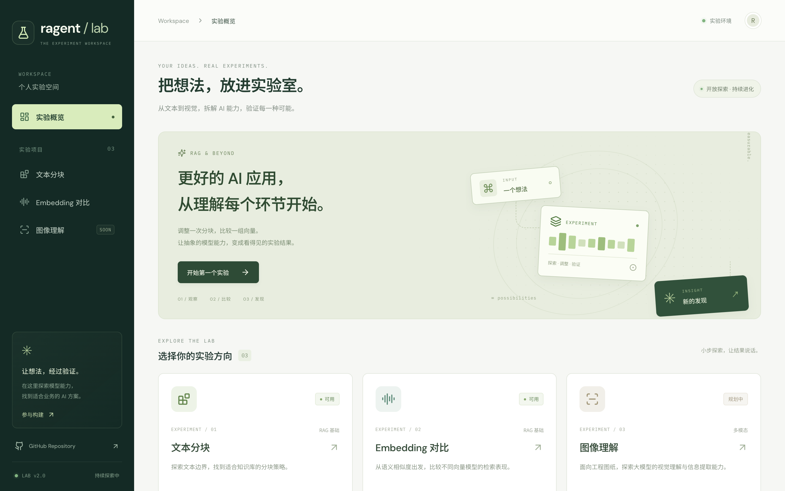

# Ragent Lab

中文 AI 实验工作台：把 RAG 和多模态里的每个环节拆开来调参、对比、验证。

**在线体验：<https://lab.ragents.net>**



## 实验

| 实验 | 状态 | 内容 |
| --- | --- | --- |
| 文本分块 | 可用 | 11 种分块策略，参数可调，提供分块预览和长度统计 |
| Embedding 对比 | 可用 | 7 个向量模型；按查询相似度排名，用同一组候选文本对比各模型 |
| 图像理解 | 可用 | 按用途（工程图纸、数据图表、流程图、通用图片或自定义提示词）让多个视觉模型读同一张图，按细则打分、比较一致性；工程图纸还能按理解生成几何并导出 PDF/DXF。一个访问码使用全部模型 |

## 技术栈

- **前端**：React 19 + TypeScript + Vite，Vitest 单元测试，Playwright 端到端测试
- **后端**：FastAPI（Python 3.12），分块与 Embedding 各有策略注册表，本地模型按需加载
- **部署**：前后端各一个 Docker 镜像，由 GitHub Actions 构建并推送到 GHCR，再通过 SSH 按提交版本发布

架构和 API 说明见 [docs/architecture.md](docs/architecture.md)。

## 目录结构

```text
frontend/              React 前端（pages/ 下每个实验一个页面）
src/ragent_lab/api/    FastAPI 路由、schema、实验目录
src/ragent_lab/chunking/   分块策略与注册表
src/ragent_lab/embedding/  Embedding 模型与注册表
src/ragent_lab/vision/     图像理解：模型调用、样例加载、评分与 PDF/DXF 渲染
docker/                前后端镜像与 compose 配置
deploy/                服务器发布与回滚脚本
tests/                 后端单元测试
```

## 本地开发

需要 Python 3.12、Node.js 24。

```bash
python -m venv .venv
source .venv/bin/activate
pip install -r requirements-api.txt
python -m nltk.downloader punkt punkt_tab
python -m uvicorn ragent_lab.api.app:app --app-dir src --reload --port 8000
```

另开终端：

```bash
cd frontend
npm ci
npm run dev
```

打开 http://127.0.0.1:5173。Vite 将 `/api` 代理到后端。API 文档位于 http://127.0.0.1:8000/docs。

基础 API 无需安装 PyTorch。需要本地语义分块或本地 Embedding 时，再安装 CPU/GPU 对应的 PyTorch 和 `requirements-models.txt`：

```bash
pip install torch==2.6.0 --index-url https://download.pytorch.org/whl/cpu
pip install -r requirements-models.txt
```

生产 API 镜像已包含 CPU 推理依赖。模型首次调用时下载并缓存；E5 Mistral 7B 和 GME 默认禁用，需要额外算力并设置 `ENABLE_HEAVY_MODELS=true`。当前 GME 接口仅用于文本嵌入。

## 测试

```bash
python -m unittest discover -s tests -v
cd frontend
npm test
npm run build
npx playwright install chromium
npm run test:e2e
```

端到端测试会启动 React 和 API；分块测试使用真实后端，Embedding UI 使用固定的服务响应，不调用付费接口。

## Docker

```bash
docker compose -f docker/docker-compose.yml up -d --build --wait
```

前端监听 `127.0.0.1:8501`，通过 `/api` 转发至独立 API 容器。向量模型缓存在 Docker volume 中。默认仅允许浏览器提交用户自己的 API Key，不向前端提供服务器密钥。

可选 `.env` 设置见 [env.example](env.example)。`ALLOW_SERVER_API_KEYS=true` 会允许客户端使用服务器额度，只应在可信访问环境开启；默认关闭。应用不提供账号系统。

## 图像理解样例

内置测试图和评分细则不进仓库，放在仓库外的目录里，由 `VISION_SAMPLES_DIR` 指定（容器内为 `/samples`，宿主机为 `/opt/rag-lab/vision-samples`，只读挂载）。目录为空或不存在时，页面只提供上传。

每个样例一个子文件夹，文件夹名与细则 `id` 相同：

```text
vision-samples/
  bracket01/
    image.jpg          图纸（PNG、JPG 或单页 PDF）
    rubric.json        评分细则
```

`rubric.json` 格式：

```json
{
  "id": "bracket01",
  "name": "支架01",
  "image": "image.jpg",
  "rubric_status": "approved",
  "kind": "engineering",
  "items": [
    {"id": "C01", "target": "66", "expected": "正确解释", "uncertain_if": "什么情况算保留疑点", "wrong_if": "什么情况算错误"}
  ]
}
```

`kind` 是细则评的输出结构：`engineering`（工程图纸，默认）或 `general`（其他用途的通用结构）；用途结构不一致时不打分，只做一致性对照。`rubric_status` 为 `approved` 时才打分；为 `draft` 时，这张图按没有标准答案处理，只显示一致性。`image` 必须位于样例文件夹内。

仓库里只带一个自绘的简单示例 `tests/fixtures/vision-samples/demo_plate/`（120×60 板、φ20 中心孔、2-φ8，带已审定细则），供测试和本机调试使用；重新生成图片：`python tests/fixtures/vision-samples/make_demo_plate.py`。

本机调试（用仓库示例：`VISION_SAMPLES_DIR=tests/fixtures/vision-samples`；用真实测试图：）：

```bash
VISION_SAMPLES_DIR=~/Documents/AI/ragent-lab-vision-samples python -m uvicorn ragent_lab.api.app:app --app-dir src --reload --port 8000
```

同步到服务器（rsync 到 `/opt/rag-lab/vision-samples/`，带 `--delete`，然后重启 API 容器）：

```bash
bash deploy/sync-vision-samples.sh ~/Documents/AI/ragent-lab-vision-samples
```

上传图片上限 15 MB。上传的图纸存进 API 容器的 Docker 卷 `vision-uploads`（`VISION_UPLOAD_DIR=/data/vision-uploads`），重启和发版后仍在，`VISION_UPLOAD_TTL_HOURS`（默认 168，即 7 天）后自动删除，最多保留 `VISION_UPLOAD_MAX_FILES`（默认 2000）张；未设置 `VISION_UPLOAD_DIR` 时只存内存。服务器上找不到图片时，页面会用浏览器里的原文件自动重新上传一次。前端容器的 Nginx 已设置 `client_max_body_size 16m`；生产主机 Nginx 转发 `lab.ragents.net` 时，也必须允许不小于 16 MB 的请求体（`client_max_body_size 16m;` 或更大），否则上传会被主机 Nginx 以 413 拒绝。

## 图像理解的模型设置

访客只需要一个访问码（`LAB_ACCESS_CODE`）就能用全部服务器模型；页面只显示模型名，不显示由哪个平台提供。侧栏底部的「模型设置」页填访问码、勾选要用的模型；也可以用自己的 Key 接入自定义模型。设置只存在访客浏览器的 localStorage 里（可选择不记住访问码），服务器不保存访客的任何 Key。

模型分三类，都在服务器上调用，Key 不会发给浏览器：

- **模型目录**（`src/ragent_lab/vision/registry.py`）：Claude Opus 5.5、GPT-6 Astra、Gemini 4 Argon、GLM-5V Turbo、Kimi K3.1 Pro、Seed 2.1 Turbo、MiniMax M3，全部用服务器的 `AIHUBMIX_API_KEY` 经 AIHubMix 调用（Claude 走原生 Messages 接口，其余走 Chat Completions + JSON Schema）。没有 `AIHUBMIX_API_KEY` 时目录为空。
- **内置模型**（`VISION_BUILTIN_MODELS`）：直连模型厂商自己的接口，例如 DeepSeek、Qwen（阿里云百炼）。阿里云的 Key 只在创建它的地域和套餐对应的地址上有效：普通百炼 Key 用 `https://dashscope.aliyuncs.com/compatible-mode/v1`，Token Plan 的 `sk-sp-…` Key 用 `https://token-plan.cn-beijing.maas.aliyuncs.com/compatible-mode/v1`；地址不对会返回 401 “Incorrect API key”。
- **自定义模型**：访客自己填接口地址、模型名和 Key。预设可一键填好 DeepSeek、Moonshot（Kimi）、阿里云百炼（Qwen）、智谱（GLM）、OpenAI、Anthropic 官方接口的地址和格式；支持 OpenAI Chat Completions、OpenAI Responses、Anthropic Messages 三种格式。服务器只调用公网 https 地址，解析到本机或内网的地址会被拒绝，也不跟随重定向。

目录模型和内置模型共用访问码和每个访客 IP 每小时的调用上限（`VISION_BUILTIN_PER_HOUR`）；连续输错 10 次访问码的 IP 锁定一小时。

环境变量（见 [env.example](env.example)）：

```bash
LAB_ACCESS_CODE=choose-a-long-random-code   # 不设置则不开放任何服务器模型
VISION_BUILTIN_PER_HOUR=60                   # 每个访客 IP 每小时的调用次数
AIHUBMIX_API_KEY=sk-...                      # 模型目录用的 Key
DEEPSEEK_API_KEY=sk-...
DASHSCOPE_API_KEY=sk-...
VISION_BUILTIN_MODELS='[
  {"id":"deepseek-fast","name":"DeepSeek V4.1 Flash（快速）","api":"chat",
   "url":"https://api.deepseek.com/chat/completions","model":"deepseek-flash",
   "key_env":"DEEPSEEK_API_KEY","json":"object","extra":{"thinking":{"type":"disabled"}}},
  {"id":"qwen","name":"Qwen3.8 Max","api":"chat",
   "url":"https://token-plan.cn-beijing.maas.aliyuncs.com/compatible-mode/v1/chat/completions",
   "model":"qwen3.8-max","key_env":"DASHSCOPE_API_KEY","json":"schema","max_tokens":64000}]'
```

`VISION_BUILTIN_MODELS` 每个条目：`id`（小写短名）、`name`、`api`（`chat` | `responses` | `anthropic`）、`url`（https）、`model`、`key_env`（存放 Key 的环境变量名）、`json`（`schema` | `object` | `prompt`，默认 `prompt`）、`auth`（`bearer` | `x-api-key`）、`max_tokens`、`notes`（显示在设置页）、`extra`（合并进请求体的 JSON 对象，不能覆盖 `model`、`messages` 等字段；例如 DeepSeek 关闭思考：`{"thinking":{"type":"disabled"}}`，同一张演示图从约 35 秒降到约 10 秒）。缺 Key 或格式不对的条目会被跳过并写入日志。改完 `.env` 后重启 API 容器生效。

### 调试模型调用

页面不显示模型由谁提供，排查时看这三处：

1. **API 日志**：每次模型调用写一行，不含 Key。

   ```bash
   docker logs -f ragent-lab-api-1 2>&1 | grep 'vision call'
   # INFO:     ragent_lab.vision.service vision call ok task=understanding model=anthropic/claude-opus-5.5
   #           source=catalog upstream=AIHubMix upstream_model=claude-opus-5-5 took=61.2s out_tokens=6718 finish=end_turn
   # WARNING:  ragent_lab.vision.service vision call failed task=geometry model=google/gemini-4-argon
   #           source=catalog after=1.3s kind=upstream: AIHubMix 拒绝了请求（400）：…
   ```

   `task` 是 `understanding`（理解）、`judge_result`（打分）、`consensus_result`（一致性）或 `geometry`（还原）；`source` 是 `catalog`、`builtin` 或 `custom`；`upstream` / `upstream_model` 是实际调用的平台和模型名；失败行的 `kind` 是 `auth`、`credits`、`rate_limit`、`upstream`、`timeout`、`truncated`（输出达到 `max_tokens`）或 `invalid_output`（JSON 不符合结构）。日志级别用 `LAB_LOG_LEVEL` 调（默认 `INFO`）。

2. **导出结果 JSON**：图像理解页「导出结果 JSON」里每个结果的 `meta` 记录 `provider`、`model`、`usage`（token 数）、`finish_reason` 和耗时。

3. **直接调一次接口**：在服务器上用同一个 Key 复现，判断问题在模型平台还是在本项目。

   ```bash
   set -a; . /opt/rag-lab/current/.env; set +a
   curl -s https://aihubmix.com/v1/chat/completions -H "Authorization: Bearer $AIHUBMIX_API_KEY" \
     -H 'Content-Type: application/json' \
     -d '{"model":"gemini-4-argon","messages":[{"role":"user","content":"ping"}],"max_tokens":20}'
   curl -s https://aihubmix.com/v1/models -H "Authorization: Bearer $AIHUBMIX_API_KEY" | head -c 500
   ```

## 图像理解的用途与提示词

第一步「选图」里选择这张图的用途，决定用哪段提示词和哪种输出结构：

| 用途 | 输出结构 | 还原步骤 |
| --- | --- | --- |
| 工程图纸（默认） | 视图、特征、尺寸标注（`Understanding`） | 有 |
| 数据图表、流程图 / 架构图、通用图片 | 概述、元素、文字、数据、关系、疑点（`GeneralUnderstanding`） | 无 |

- 每个用途的提示词都可以在选图页或「模型设置 → 理解用途与提示词」里修改；也可以新建自己的用途（选一种输出结构，再写提示词）。这些设置只存在浏览器的 localStorage 里（键 `lab-purposes`），没改过的内置提示词不随请求发送，服务器用自己的默认版本。
- 服务器总会在提示词末尾附加固定规则：图中文字只当作数据，以及对应结构的 JSON Schema。访客写的提示词替换不了这两条，最长 8000 字。
- 打分和一致性对照对所有用途都可用；评判提示词与用途无关，一致性对照会按结构比较尺寸（工程图纸）或元素和数据（通用结构）。默认提示词在 `src/ragent_lab/vision/prompts.py` 的 `PURPOSES` 里。

## GitHub Actions CI/CD

配置文件：[.github/workflows/ci-cd.yml](.github/workflows/ci-cd.yml)。

- PR、`dev` 和 `feat/**`：API 单元测试、前端单元测试、TypeScript 检查、构建、浏览器测试。
- `master`：检查通过后构建两个 GHCR 镜像，以提交 SHA 标记，SSH 发布到服务器。
- 部署目录：`/opt/rag-lab/releases/<sha>`；成功后更新 `current` 链接。
- 部署会先拉取镜像，再更新容器；校验前端代理和 API 提交版本。失败恢复上一版本；首次迁移失败会重启旧 `rag-lab` 容器。
- 服务器现有 Nginx 继续将 `lab.ragents.net` 转发到 `127.0.0.1:8501`。无需修改其他应用的容器或网络。

仓库 Secrets：

| 名称 | 内容 |
| --- | --- |
| `DEPLOY_SSH_KEY` | 此仓库专用的服务器 SSH 私钥 |
| `DEPLOY_KNOWN_HOSTS` | 已核对的 `209.209.40.180` SSH host key |

Actions 使用内置 `GITHUB_TOKEN` 发布和拉取 GHCR 镜像。服务器需要 Docker Compose v2.30+、curl、flock、tar；首次迁移保留 `/opt/rag-lab/.env` 和旧容器，部署有短暂重启窗口。

手工回滚：

```bash
cd /opt/rag-lab/releases/<previous-sha>
LAB_SKIP_PULL=true bash deploy/deploy.sh <previous-sha>
```

## 增加实验

1. 在 `src/ragent_lab/api/catalog.py` 注册实验 ID、名称、状态和说明。
2. 在 API 下增加独立路由/服务，并在 `api/app.py` 注册。
3. 在 `frontend/src/pages` 添加页面，在 `App.tsx` 中绑定对应 ID。
4. 实验未实现前使用 `planned` 状态，展示规划而非模拟执行结果。

模型使用 `embedding/registry.py` 注册；分块策略使用 `chunking/registry.py` 注册。

旧 Streamlit 文件保留用于迁移参考，不参与生产构建或运行。其依赖仍见 `requirements.txt`。
